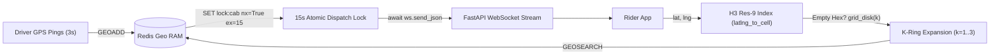

# Main To Scale — Real-Time Ride Matcher Starter Kit

Runnable companion code for the **Main To Scale** Short: *"From one 5-line loop, you just invented how Uber and Zomato match your ride in real time."*

Every example uses **Bengaluru coordinates (`12.9716, 77.5946`)**, **Uber H3 v4**, **Redis Geo / Atomic Locks** (with automatic `fakeredis` fallback if Docker/Redis isn't running), and **FastAPI WebSockets**.

---

## Beat-to-Code Map

| Video Beat | Concept | Runnable File | Key API / Pattern |
| --- | --- | --- | --- |
| Beat 1 (`hook`) | 5-line O(N) distance scan (10 vs 100K cabs) | [`01_naive_loop.py`](01_naive_loop.py) | `pairs.append((dist(pos, d), d))` |
| Beat 2 (`h3-hex-grid`) | Slice the city into H3 hex cells | [`02_h3_hex_and_kring.py`](02_h3_hex_and_kring.py) | `h3.latlng_to_cell(lat, lng, 9)` |
| Beat 3 (`redis-geo`) | 3s GPS pings in RAM instead of disk DB | [`03_redis_geo_dispatch.py`](03_redis_geo_dispatch.py) | `redis.geoadd` / `redis.geosearch` |
| Beat 4 (`websocket-push`) | Push live coordinates with zero polling | [`04_live_ws_server.py`](04_live_ws_server.py) + [`static/index.html`](static/index.html) | `await ws.send_json(...)` |
| Beat 5 (`h3-ring-expand`) | Rush hour empties your hex -> expand outward | [`02_h3_hex_and_kring.py`](02_h3_hex_and_kring.py) | `h3.grid_disk(cell, k)` |
| Beat 6 (`redis-lock`) | Stop double-dispatch with a 15s lock | [`03_redis_geo_dispatch.py`](03_redis_geo_dispatch.py) | `redis.set(f"lock:{cab_id}", rider_id, nx=True, ex=15)` |

---

## System Architecture



```text
Driver Pings ──(GEOADD)──▶ Redis Geo RAM ◀──(GEOSEARCH)── H3 Res-9 + grid_disk(k)
                                │                                    │
                                └──────▶ SET lock:{cab} nx=True ex=15
                                                      │
                                          await ws.send_json(...)
                                                      ▼
                                            Rider Live Dashboard
```

---

## 2-Minute Setup

### Option A: Zero-Docker Local Mode (Fastest)
If `localhost:6379` is not running, `03_redis_geo_dispatch.py` and `04_live_ws_server.py` automatically fall back to in-memory `fakeredis` with a console notice.

**Windows (PowerShell):**
```powershell
cd ride-matcher-kit
python -m venv .venv
.venv\Scripts\Activate.ps1
pip install -r requirements.txt
```

**macOS / Linux:**
```bash
cd ride-matcher-kit
python3 -m venv .venv
source .venv/bin/activate
pip install -r requirements.txt
```

### Option B: With Real Redis (`docker compose`)
```bash
docker compose up -d
```

### Run Each Beat in Order
```bash
python 01_naive_loop.py
python 02_h3_hex_and_kring.py
python 03_redis_geo_dispatch.py
python 04_live_ws_server.py
```
Then open **http://127.0.0.1:8000** to watch the live Bengaluru H3 grid, WebSocket cab trails, and 15-second Redis lock timers.

---

## Try Breaking It Yourself

1. **See the O(N) wall in `01_naive_loop.py`:** Add `500_000` to the `for n in (10, 10_000, 100_000):` tuple and watch single-request latency climb past ~1 second per rider.
2. **Empty a deeper ring in `02_h3_hex_and_kring.py`:** Change `h3.grid_disk(cell, 1)` to `h3.grid_disk(cell, 2)` when clearing cells and observe `grid_disk` expand to `k=3` (37 hex cells).
3. **Trigger a live race condition in the dashboard:** Click **Race 2 Riders** on `http://127.0.0.1:8000` — both `Rider-A` and `Rider-B` fire `asyncio.gather` at the exact same millisecond, yet only one acquires `nx=True, ex=15` while the other gets rejected.
4. **Watch Rush-Hour K-Ring expansion live:** Click **Rush Hour (Empty Hex)** to push cabs out of `k=0` and `k=1`, then click **Request Ride** to see the green `grid_disk(k=2)` ring light up across Bengaluru.
