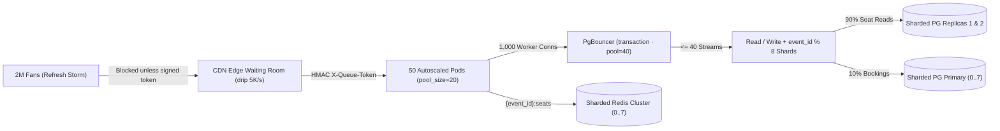

# Main To Scale — 2M-Fan Ticket Drop Scaling (Part 2) Starter Kit

Runnable companion code for the **Main To Scale** Part 2 Short: *"Congratulations — you just stopped your own autoscaler from crashing production, and built how real stadium ticket drops survive two million fans."*

Every Python example runs locally out of the box using real **SQLAlchemy Connection Pools & Sessions**, **PgBouncer Transaction Pooling**, **Read/Write Replica Routing**, **Event-ID Sharding + Redis Hash-Tag Co-location** (with automatic `fakeredis` + in-memory/temp SQLite fallback if Docker/Postgres/Redis aren't running), and an interactive **FastAPI + WebSocket + CDN Edge Waiting Room** dashboard.

---

## Beat-to-Code Map

| Video Beat | Concept | Runnable File | Key API / Pattern |
| --- | --- | --- | --- |
| Beat 1 (`50 Scaled Pods`) | 50 workers × `pool_size=20` = `1,000` connections trigger `FATAL: too many clients already` | [`01_autoscaler_ddos_and_pgbouncer.py`](01_autoscaler_ddos_and_pgbouncer.py) | `engine = create_engine(DB_URL, pool_size=20, max_overflow=10)` |
| Beat 2 (`PgBouncer Pool`) | Funnel 1,000 worker connections down to 40 real Postgres streams | [`pgbouncer.ini`](pgbouncer.ini) + [`01_autoscaler_ddos_and_pgbouncer.py`](01_autoscaler_ddos_and_pgbouncer.py) | `pool_mode = transaction` · `default_pool_size = 40` |
| Beat 3 (`Read Replicas`) | Keep 90% seat browsing from starving 10% checkout writes | [`02_read_replicas.py`](02_read_replicas.py) | `with Session(replica_db) as r:` / `with Session(primary_db) as w:` |
| Beat 4 (`Event-ID Sharding`) | Isolate hot stadium drops across 8 DB shards & Redis Cluster hash tags | [`03_event_sharding.py`](03_event_sharding.py) | `shard = db_shards[event_id % 8]` · `rkey = '{%d}:seats' % event_id` |
| Beat 5 (`Edge Waiting Room`) | Absorb 2M refreshes at the CDN and drip 5,000 signed buyers/sec | [`edge_gate.ts`](edge_gate.ts) + [`04_live_scale_server.py`](04_live_scale_server.py) + [`static/index.html`](static/index.html) | `if (!verifyQueueToken(req)) return waitingRoom();` |

---

## System Architecture



```text
2M Fans ──▶ CDN Edge Waiting Room (if !verifyQueueToken -> 202 Queue, drip 5,000/s)
                  │
                  ▼ (signed HMAC token)
             50 Pods (1,000 conns) ──▶ PgBouncer (40 pooled DB streams)
                  │                                   │
                  ▼ ({event_id}:seats)                ▼ (event_id % 8)
       Sharded Redis Cluster               Primary (10% Writes) + Replicas (90% Reads)
```

---

## 2-Minute Setup

### Option A: Zero-Docker Local Mode (Fastest)
If Postgres (`5432`), PgBouncer (`6432`), or Redis (`6379`) are not running locally, every script automatically runs against real SQLAlchemy pools/sessions (in-memory/temp SQLite) and in-memory `fakeredis` with a console notice — leaving zero `.db` artifacts behind.

**Windows (PowerShell):**
```powershell
cd ticket-scale-kit
python -m venv .venv
.venv\Scripts\Activate.ps1
pip install -r requirements.txt
```

**macOS / Linux:**
```bash
cd ticket-scale-kit
python3 -m venv .venv
source .venv/bin/activate
pip install -r requirements.txt
```

### Option B: With Real Postgres + PgBouncer + Redis (`docker compose`)
```bash
docker compose up -d
```

### Run Each Beat in Order
```bash
python 01_autoscaler_ddos_and_pgbouncer.py
python 02_read_replicas.py
python 03_event_sharding.py
python 04_live_scale_server.py
```
Then open **http://127.0.0.1:8000** to toggle every scaling layer live, trigger the 50-pod autoscaler DDoS or 2M-fan refresh storm, mint HMAC-SHA256 queue tokens, and test seat checkouts across isolated shards.

---

## Try Breaking It Yourself

1. **Trigger `FATAL: too many clients already` in `01_autoscaler_ddos_and_pgbouncer.py`:** Lower `PG_MAX_CONNECTIONS = 100` to `50` and watch direct autoscaled pods fail 95% of bursts while `PgBouncer (default_pool_size = 40)` still finishes `1,000 / 1,000` transactions with `0` errors.
2. **Starve checkout writes in `02_read_replicas.py`:** Increase `TOTAL_REQUESTS = 200` to `600` (keeping 90% reads / 10% writes) and watch single-primary checkout p95 latency climb while `replica_db` + `primary_db` keeps checkouts fast.
3. **Prove Redis Cluster slot co-location in `03_event_sharding.py`:** Inspect `{101}:seats`, `{101}:locks`, and `{101}:queue` — the CRC16 hash-tag extractor guarantees all three land on the **same Redis slot** (`% 16384`) while `event_id % 8` routes Event A, B, and C to separate DB shards.
4. **Storm the live server at `http://127.0.0.1:8000`:** Click **Beat 1: 50-Pod DDoS** and hit **Book Seat** to see `503` connection exhaustion; switch to **Beat 5: +Edge Shield (2M Fans)**, click **Request Without Token** (`202` Waiting Room), then **Mint Signed Token** and **Book Seat** (`200 OK` with shard + `{event_id}:seats` key).
