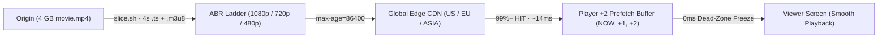

# Main To Scale — Netflix & YouTube Video Streaming Starter Kit

Runnable companion code for the **Main To Scale** Short: *"Congratulations — from one raw video file, you just invented how Netflix and YouTube stream at global scale."*

Every Python example runs locally out of the box using real **HLS 4-Second Chunking (`.ts` + `.m3u8`)**, **Adaptive Bitrate (`1080p` / `720p` / `480p`) Switching**, **Regional Edge CDN POP Caching (`Cache-Control: public, max-age=86400`)** (with automatic `fakeredis` fallback if Docker/Redis isn't running), and an interactive **FastAPI + Canvas + +2 Prefetch Playhead Buffer** streaming dashboard.

---

## Beat-to-Code Map

| Video Beat | Concept | Runnable File | Key API / Pattern |
| --- | --- | --- | --- |
| Beat 1 (`hook`) | 4-line `main()` streaming raw 4 GB `movie.mp4` buffers & crashes | [`01_naive_raw_stream.py`](01_naive_raw_stream.py) | `data = f.read()` -> `502 CRASH` |
| Beat 2 (`hls-chunking`) | Slice movie into 4-second `.ts` chunks indexed by `.m3u8` | [`slice.sh`](slice.sh) + [`02_hls_chunking_and_abr.py`](02_hls_chunking_and_abr.py) | `ffmpeg -i movie.mp4 ... -hls_time 4 index.m3u8` |
| Beat 3 (`adaptive-bitrate`) | Switch `1080p`, `720p`, `480p` mid-play when tunnel drops 5G -> 3G | [`02_hls_chunking_and_abr.py`](02_hls_chunking_and_abr.py) | `def pick_tier(mbps): ...` |
| Beat 4 (`edge-cdn`) | Cache popular chunks at regional Edge CDN POPs worldwide | [`cdn/_headers`](cdn/_headers) + [`03_edge_cdn_and_prefetch.py`](03_edge_cdn_and_prefetch.py) | `Cache-Control: public, max-age=86400` |
| Beat 5 (`prefetch-buffer`) | Prefetch the next 2 chunks ahead of the playhead across dead zones | [`03_edge_cdn_and_prefetch.py`](03_edge_cdn_and_prefetch.py) + [`04_live_stream_server.py`](04_live_stream_server.py) | `buffer.append(next_seg)` / `play(buffer.popleft())` |

---

## System Architecture



```text
movie.mp4 (4 GB) ──▶ 4s .ts Chunks + .m3u8 ──▶ ABR Tiers (1080p/720p/480p)
                                                       │
                                      Cache-Control: public, max-age=86400
                                                       ▼
Viewer Screen ◀── Prefetch Buffer [NOW, +1, +2] ◀── Edge CDN (US / EU / ASIA)
```

---

## 2-Minute Setup

### Option A: Zero-Docker Local Mode (Fastest)
If `localhost:6379` is not running, `03_edge_cdn_and_prefetch.py` and `04_live_stream_server.py` automatically fall back to in-memory `fakeredis` with a console notice.

**Windows (PowerShell):**
```powershell
cd video-streaming-kit
python -m venv .venv
.venv\Scripts\Activate.ps1
pip install -r requirements.txt
```

**macOS / Linux:**
```bash
cd video-streaming-kit
python3 -m venv .venv
source .venv/bin/activate
pip install -r requirements.txt
```

### Option B: With Real Redis (`docker compose`)
```bash
docker compose up -d
```

### Run Each Beat in Order
```bash
python 01_naive_raw_stream.py
python 02_hls_chunking_and_abr.py
python 03_edge_cdn_and_prefetch.py
python 04_live_stream_server.py
```
Then open **http://127.0.0.1:8000** to watch the live Canvas HLS player, signal bars dipping `5G -> 4G -> 3G -> Dead Zone`, `+2` prefetch buffer slots draining and refilling, and regional Edge CDN cache headers.

---

## Try Breaking It Yourself

1. **See the 4 GB monolith wall in `01_naive_raw_stream.py`:** Notice how `1` viewer on fast Wi-Fi starts cleanly, while `10,000` concurrent `f.read()` requests demand `40,000 GB` of RAM and choke the 10 Gbps pipe into a `502 CRASH`.
2. **Survive the train tunnel in `02_hls_chunking_and_abr.py`:** Watch `Fixed 1080p` stall on every `3.2 Mbps` and `1.3 Mbps` tunnel chunk while `pick_tier(mbps)` seamlessly drops `1080p -> 720p -> 480p` with `0` stalls.
3. **Compare Origin vs Edge CDN on `http://127.0.0.1:8000`:** Click **Edge CDN (max-age=86400): ON** -> **Global Viewer Storm (300 reqs)** and watch Origin CPU stay cool while Edge Hit Rate jumps above `98%`; then toggle Edge CDN **OFF** and trigger another storm to watch Origin CPU spike and latency climb past `840 ms`.
4. **Test the Dead-Zone Buffer on `http://127.0.0.1:8000`:** Click **Simulate Train Tunnel (5G -> 3G -> Dead Zone)** with **Prefetch +2 Buffer: ON** (`0` stalls!), then toggle **Prefetch +2 Buffer: OFF** and repeat to see the yellow buffering spinner appear immediately when signal drops to `0 B/s`.
