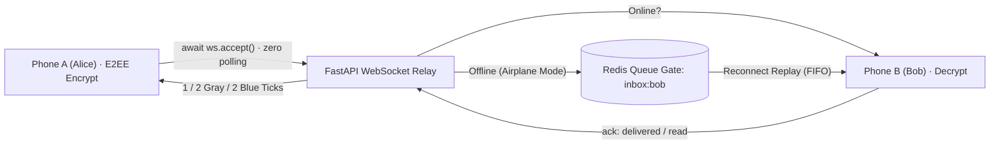

# Main To Scale — WhatsApp-Style Real-Time Chat Starter Kit

Runnable companion code for the **Main To Scale** Short: *"Congratulations — from one 5-line chat loop, you just invented WhatsApp."*

Every example runs locally with **FastAPI Persistent WebSockets**, **Redis Offline Queues** (with automatic `fakeredis` fallback if Docker/Redis isn't running), **Delivery & Read Receipt ACKs**, and **PyNaCl / Web Crypto End-to-End Encryption**.

---

## Beat-to-Code Map

| Video Beat | Concept | Runnable File | Key API / Pattern |
| --- | --- | --- | --- |
| Beat 1 (`hook`) | 5-line chat list + 1s polling meltdown | [`01_naive_polling.py`](01_naive_polling.py) | `inbox.append((user, text))` |
| Beat 2 (`websocket-push`) | Keep one persistent WebSocket open per phone | [`04_live_chat_server.py`](04_live_chat_server.py) + [`static/index.html`](static/index.html) | `await ws.accept()` |
| Beat 3 (`redis-offline-queue`) | Queue offline messages when a friend hits Airplane Mode | [`02_redis_offline_queue_and_acks.py`](02_redis_offline_queue_and_acks.py) | `redis.rpush(f"inbox:{uid}", msg)` |
| Beat 4 (`delivery-receipts`) | Single, double gray, and double blue tick receipts | [`02_redis_offline_queue_and_acks.py`](02_redis_offline_queue_and_acks.py) | `ack = {"id": msg_id, "status": "delivered"}` |
| Beat 5 (`e2e-encryption`) | Encrypt on sender's phone before crossing breached server | [`03_e2e_encryption.py`](03_e2e_encryption.py) | `cipher = box.encrypt(text)` |

---

## System Architecture



```text
Phone A (box.encrypt) ──(WebSocket)──▶ FastAPI Relay ──▶ Online? ──▶ Phone B (Decrypt)
                                             │                         │
                                       Airplane Mode              ack: delivered/read
                                             ▼                         ▼
                                  redis.rpush("inbox:bob") ──────▶ Phone A Ticks (✓ -> ✓✓ -> Blue)
```

---

## 2-Minute Setup

### Option A: Zero-Docker Local Mode (Fastest)
If `localhost:6379` is not running, `02_redis_offline_queue_and_acks.py` and `04_live_chat_server.py` automatically fall back to in-memory `fakeredis` with a console notice.

**Windows (PowerShell):**
```powershell
cd whatsapp-chat-kit
python -m venv .venv
.venv\Scripts\Activate.ps1
pip install -r requirements.txt
```

**macOS / Linux:**
```bash
cd whatsapp-chat-kit
python3 -m venv .venv
source .venv/bin/activate
pip install -r requirements.txt
```

### Option B: With Real Redis (`docker compose`)
```bash
docker compose up -d
```

### Run Each Beat in Order
```bash
python 01_naive_polling.py
python 02_redis_offline_queue_and_acks.py
python 03_e2e_encryption.py
python 04_live_chat_server.py
```
Then open **http://127.0.0.1:8000** to watch Alice's phone, the Redis queue gate, the Hacked Server wire sniffer, and Bob's phone live.

---

## Try Breaking It Yourself

1. **See the 1s polling wall in `01_naive_polling.py`:** Add `5_000_000` to `for chats in (2, 10_000, 1_000_000):` and watch redundant empty-poll bandwidth surge past hundreds of MB/s.
2. **Test the Redis Queue Gate live:** On `http://127.0.0.1:8000`, click **Bob Airplane Mode: ON**, click **Burst 4 Msgs** on Alice's phone (`M1..M4` stack inside `inbox:bob` while Alice stays at 1 gray tick), then turn Airplane Mode **OFF** to watch all 4 replay in order and upgrade to 2 gray ticks.
3. **Trigger 2 Blue Read Ticks:** Keep **Auto-read** unchecked on Bob's phone, send `"Meet at 9"` (watch `sent` -> `delivered`), then click **Mark All Read (Blue Ticks)** to illuminate both ticks cyan-blue on Alice's screen.
4. **Breach the Server with & without E2EE:** Send a message with **E2EE Lock: OFF** (the crimson **Hacked Server Wire Sniffer** captures plaintext `"Meet at 9"`), then flip **E2EE Lock: ON** and watch the server capture only scrambled AES-GCM ciphertext (`0% READABLE`) while Bob still reads the message.
